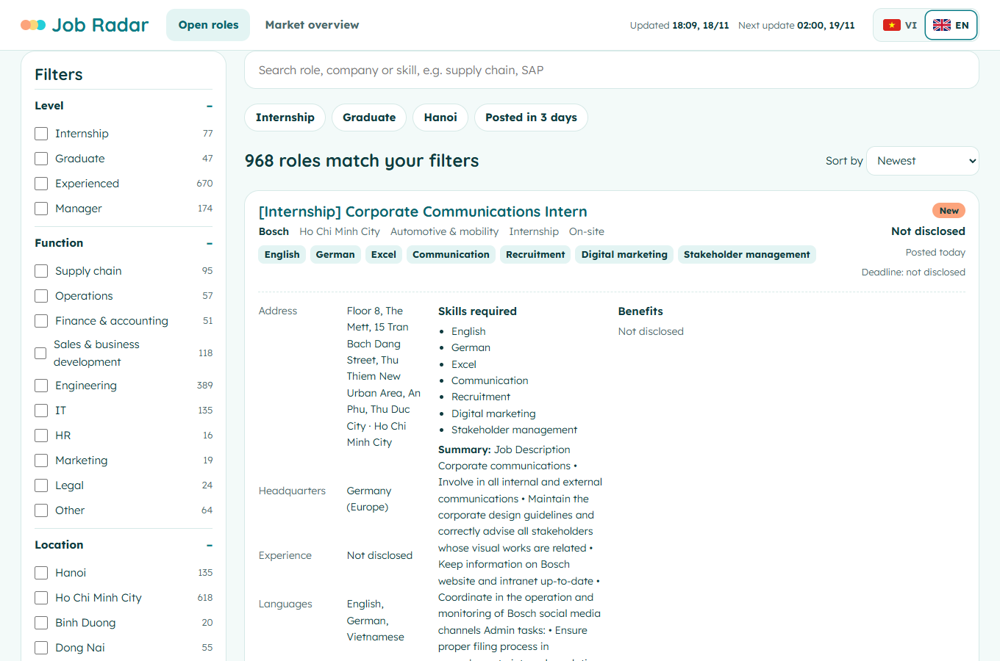
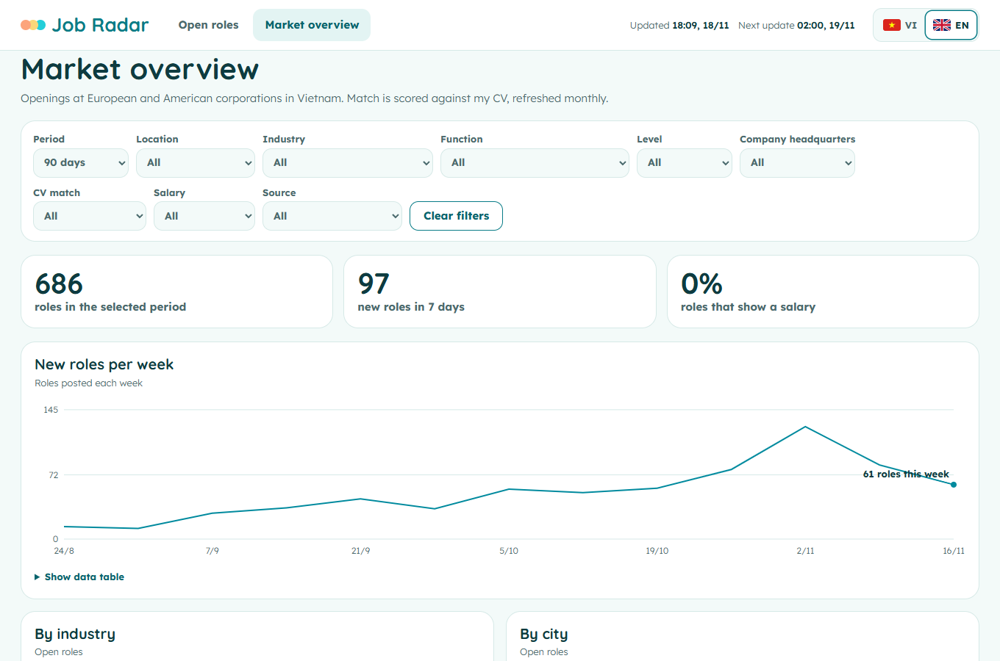
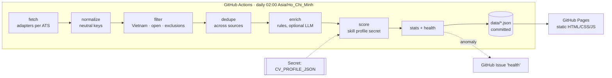

# Job Radar

**Live site:** https://ptpt1801.github.io/job-radar/

Job Radar is a daily-updated board of **open roles in Vietnam at European, American and Singaporean corporations**. It covers supply chain, industrial, tech, pharma, consulting and non-food consumer companies, and leaves out food and beverage FMCG. Each role gets a **match score** against a private skill profile. The site is static, free to run, and refreshed by GitHub Actions every night.

### The problem

Multinationals post Vietnam openings on their own career sites, not on one board. Most of those sites run on applicant tracking systems such as Workday or SmartRecruiters, and very few let you filter by country. Checking 40+ career sites by hand every week is slow and easy to forget. Generic job boards mix those openings with thousands of unrelated local listings and student-club posts. Job Radar watches a curated whitelist of employers directly and shows only roles that are:

- located in Vietnam,
- still open (a deadline in the past or a role gone from the source means it is removed),
- at a company headquartered in Europe, the Americas or Singapore,
- outside food and beverage FMCG.

| Open roles | Market overview |
|---|---|
|  |  |

## How it works



| Stage | What it does |
|---|---|
| **fetch** | One adapter per platform: Workday (public CXS JSON, VN location facet), SmartRecruiters (official Posting API), Greenhouse, Lever, Ashby, plus custom adapters for Jibe/iCIMS (Schneider Electric) and Avature (Siemens). Ybox.vn is read with strict rules (see below). |
| **normalize** | Maps every posting to one schema ([`schemas/job.schema.json`](schemas/job.schema.json)) with language-neutral keys (`level`, `function`, `city`…); the UI translates them. |
| **filter** | Vietnam only, deadline not passed (Vietnam time), source status open, no excluded company or industry ([`config/exclusions.yaml`](config/exclusions.yaml)). |
| **dedupe** | Same company + normalized title + city within 14 days counts as one role. The higher-priority source wins; a lower-priority source only fills empty fields such as salary. |
| **enrich** | Rule-based extraction (no cost): skills, level, function, years of experience, salary (only when stated with a currency), benefits and languages, using the VI/EN keyword taxonomy in [`config/taxonomy.yaml`](config/taxonomy.yaml). An optional Claude Haiku mode via the Batches API exists but is off by default. |
| **score** | Deterministic formula against a skill profile (below). |
| **stats / health** | Dashboard aggregates; per-source health with automatic GitHub Issues when a source returns 0 jobs, totals drop by more than 50%, schema errors pass 5%, or the pipeline has not run for 30 hours. |

### Data sources and ethical collection

- **Whitelist, not a crawl.** Only companies in [`config/companies.yaml`](config/companies.yaml), each verified by hand (ATS, Vietnam job count, date).
- **robots.txt is respected**, including `crawl-delay`. One documented exception: `api.smartrecruiters.com` disallows generic bots in robots.txt, but it is SmartRecruiters' official public Posting API built for career sites. It is used with the repository owner's approval and the same rate limit.
- **At most 1 request per second per host**, retries with backoff on 429/5xx, 20 s timeout, and a clear User-Agent: `JobRadarBot/1.0 (+https://github.com/ptpt1801/job-radar)`.
- **No LinkedIn, no Indeed**; their terms forbid scraping. VietnamWorks/TopCV adapters exist only as disabled stubs.
- **Recruiters' phone numbers and e-mail addresses are removed** from any text that gets published.
- **Ybox.vn** mixes company jobs with student-club and volunteer posts. A post is kept only if its employer matches the whitelist (fuzzy match on the core company name, ratio ≥ 90). Posts with club/project/ambassador/volunteer keywords are dropped, and ambiguous ones are rejected and logged in `data/health.json → ybox_rejected` for monthly review.

### Match score: the CV never touches this repo

The pipeline never reads a CV. It reads a short **skill profile** (skill keys, target levels, functions and cities) from the GitHub Secret `CV_PROFILE_JSON`. The CV itself stays on the owner's computer in a git-ignored `private/` folder.

```
skill = 50 × (required skills the profile has) / (required skills)   # 25 if none listed
level = 22 if the level is a target, 12 if one step away, else 0
func  = 18 for the first target function, 12 for the others, else 0
city  = 10 if a target city or remote, else 2
match = min(99, round(skill + level + func + city))
```

Only `match`, `have[]` and `missing[]` reach the browser, and the two tag lists can be switched off with `SHOW_SKILL_TAGS: false`. A `privacy-guard` workflow fails any push that contains Vietnamese phone numbers, personal e-mail addresses, `.docx`/`.pdf` files or a `private/` folder. It prints file names only, never what it found.

## Update schedule

| When | What |
|---|---|
| Daily 02:00 (Hanoi) | `daily.yml`: fetch, process, test, privacy guard, commit `data/`, then `pages.yml` deploys |
| Sunday | Every open role's URL is re-checked; 404/410 or "no longer available" closes it |
| On demand | `rescore.yml` re-scores all open roles after the skill profile changes (no fetching) |
| Every run | Roles missing from their source two runs in a row move to `data/archive.json` (kept 180 days for trend charts) |

## Tech stack

- **Pipeline:** Python 3.12, `requests`, `BeautifulSoup`, `rapidfuzz`, `jsonschema`, `pytest`
- **Front end:** plain HTML, CSS and JavaScript with hand-written SVG charts. No framework and no build step. Bilingual (Vietnamese / English), hash routing, `localStorage` for saved roles and filters.
- **Infra:** GitHub Actions (cron, Pages deploy, health issues), GitHub Pages, GitHub Secrets

## Run locally

```bash
python -m venv .venv
.venv/Scripts/activate            # Windows  (macOS/Linux: source .venv/bin/activate)
pip install -r requirements.txt

pytest -q pipeline/tests                              # offline tests on saved real responses
python -m pipeline --dry-run --limit-companies 3      # live fetch, prints stats, writes nothing
python -m pipeline --only-new                         # full run, writes data/
python -m pipeline --rescore-all                      # re-score only (reads CV_PROFILE_JSON from env)
python scripts/privacy_guard.py

# preview the site
mkdir -p _site && cp -r site/. _site/ && cp -r data _site/data && python -m http.server -d _site 8000
```

To refresh the skill profile after a CV update, run `scripts/update_cv.ps1`. It uploads `private/cv_profile.json` to the secret and triggers `rescore.yml`.

## Repository layout

```
config/      whitelist, exclusions, taxonomy (VI/EN), settings
pipeline/    adapters/ (workday, smartrecruiters, greenhouse, lever, ashby, ybox, custom/), normalize,
             filter, dedupe, enrich_rules, enrich_claude, score, stats, health, store, tests/
data/        jobs.json, archive.json, stats.json, health.json, meta.json (written by the pipeline)
site/        index.html, assets/, i18n/
schemas/     job.schema.json
docs/        prototype.html (UI reference), screenshots
```

## License

[MIT](LICENSE)
